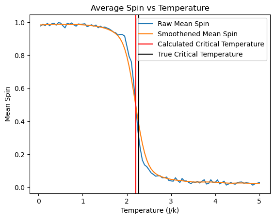
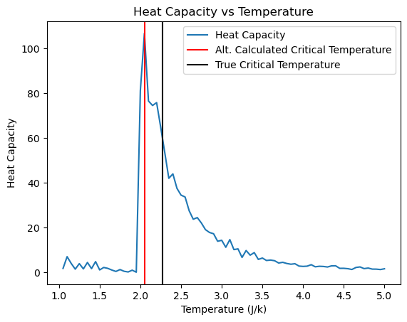

# 2-D Ising Model Simulation with the Wolff Cluster Algorithm

This Jupyter notebook simulates the 2-D Ising model of ferromagnetic spins on a 50×50 lattice using the Wolff cluster Monte Carlo algorithm. It then estimates the **critical temperature T<sub>c</sub>** of the order–disorder phase transition in four different ways and compares each to the exact value from Onsager's solution, T<sub>c</sub> ≈ 2.27 J/k<sub>B</sub>.



## What's in the notebook

`Ising_Model_Python.ipynb` explains each step as it goes:

1. **Background.** The Ising energy E = −J Σ σ<sub>i</sub>σ<sub>j</sub>, the Swendsen–Wang algorithm, and how the Wolff algorithm improves on it near T<sub>c</sub>.
2. **Lattice.** A random 50×50 lattice of ±1 spins, stored both as a NumPy array (for fast energy calculation by convolution) and as a NetworkX grid graph (for growing clusters).
3. **Wolff algorithm.** Pick a random spin, grow a cluster by adding aligned neighbors with probability p = 1 − e<sup>−2J/T</sup>, flip the cluster, and repeat.
4. **Temperature sweep.** 100 temperatures from 0.05 to 5 J/k<sub>B</sub>, with up to 1,000 Wolff iterations at each. Low temperatures stop early once the lattice is clearly ordered (|mean spin| > 0.9 for 5 iterations in a row), which keeps the runtime manageable.
5. **Estimating T<sub>c</sub>.** Four estimators, compared below.

## Results

| Method | Estimated T<sub>c</sub> (J/k<sub>B</sub>) | Error vs. 2.27 |
|---|---|---|
| **Inflection point of mean spin vs. T** | **2.20** | **3.08%** |
| Inflection point of mean energy vs. T | 2.10 | 7.49% |
| Peak of heat capacity, C = Var(E) / T² | 2.05 | 9.69% |
| Peak of magnetic susceptibility, χ = Var(M) / T | 2.00 | 11.89% |

The mean-spin method came closest. To find the inflection point, the spin curve is smoothed with a Gaussian filter, then the code finds where its second derivative changes sign.



All four estimates fall slightly below the exact value. This is expected for a small 50×50 lattice with a limited number of iterations per temperature (a finite-size effect).

## Running it

```bash
python3 -m venv .venv && source .venv/bin/activate
pip install -r requirements.txt
jupyter notebook Ising_Model_Python.ipynb
```

> **Note:** The full temperature sweep took about 4 hours on the original machine. The plots and results are saved in the notebook's outputs, so you can read the analysis without re-running it.
>
> **Numba compatibility:** the notebook's `@jit` decorators wrap functions that call NetworkX and SciPy. Numba 0.59 and later can't compile these, so `requirements.txt` pins an older Numba. See the notes in `requirements.txt`.

## References

- E. Luijten, "Introduction to Cluster Monte Carlo Algorithms," *Computer Simulations in Condensed Matter Systems*, Lecture Notes in Physics, vol. 703, Springer, 2006.
- D. P. Landau and K. Binder, *A Guide to Monte Carlo Simulations in Statistical Physics*, 4th ed., Cambridge University Press, 2014.
- A. Bourached, "Monte Carlo Simulations in the 2-dimensional Ising Model," Trinity College Dublin.
- Stanford University, "The Ising Model," https://stanford.edu/~jeffjar/statmech/intro4.html
- "The Ising Model in Python: Statistical Mechanics and Permanent Magnets," Mr. P Solver (YouTube). That video uses the Metropolis algorithm; this notebook uses Wolff.

## License

[MIT](LICENSE) © 2026 Asfar Ahmad
